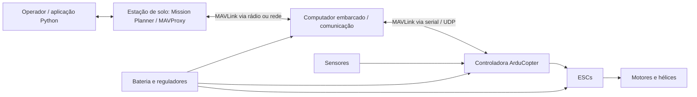
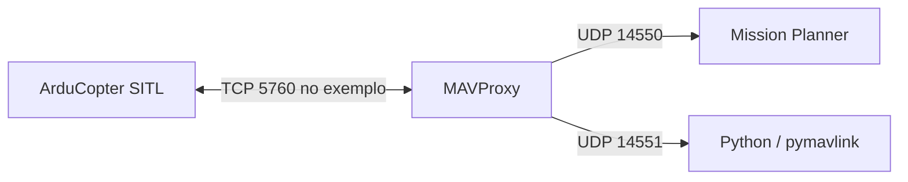

# LabDrones CEFET-RJ

**Repositório colaborativo de pesquisa, desenvolvimento e documentação de sistemas com drones.**

O **LabDrones CEFET-RJ** reúne materiais e iniciativas relacionados a veículos aéreos não tripulados (VANTs), robótica, eletrônica embarcada, controle de voo, automação, simulação e comunicação. Este espaço foi criado para facilitar a integração de novos integrantes, o compartilhamento de conhecimento e a evolução colaborativa dos projetos do grupo.

> **Novo por aqui?** Comece por [Primeiros passos](#primeiros-passos-para-novos-integrantes). Não é necessário conhecer todas as tecnologias antes de participar; esperamos curiosidade, responsabilidade e disposição para aprender e documentar os experimentos.

## Conteúdo

- [Objetivos e linhas de trabalho](#objetivos-e-linhas-de-trabalho)
- [Projeto de referência: Drone Sub-250](#projeto-de-referência-drone-sub-250)
- [Arquitetura de um sistema com drones](#arquitetura-de-um-sistema-com-drones)
- [Ferramentas e tecnologias](#ferramentas-e-tecnologias)
- [Primeiros passos para novos integrantes](#primeiros-passos-para-novos-integrantes)
- [Trilha introdutória de seis encontros](#trilha-introdutória-de-seis-encontros)
- [Preparação do ambiente](#preparação-do-ambiente)
- [Primeira simulação e leitura de telemetria](#primeira-simulação-e-leitura-de-telemetria)
- [Comunicação e integração com aeronaves reais](#comunicação-e-integração-com-aeronaves-reais)
- [Organização do repositório](#organização-do-repositório)
- [Como contribuir](#como-contribuir)
- [Registro e reprodutibilidade de experimentos](#registro-e-reprodutibilidade-de-experimentos)
- [Segurança](#segurança)
- [Documentação e referências](#documentação-e-referências)
- [Glossário](#glossário)

## Objetivos e linhas de trabalho

O laboratório busca estudar e desenvolver soluções para:

- **Eletrônica e integração:** controladoras de voo, ESCs, motores, fontes de energia, sensores e interfaces físicas.
- **Robótica e controle:** estabilização, orientação, estimação de estado, navegação e controle de movimento.
- **Automação:** planejamento de missões, comandos programáticos e rotinas de voo supervisionadas.
- **Software e simulação:** ArduPilot/ArduCopter, SITL, Mission Planner, MAVProxy e Python.
- **Comunicação:** MAVLink, redes UDP/TCP, UART, rádios XBee e sistemas de telemetria.
- **Sistemas embarcados:** integração de computadores auxiliares e serviços de comunicação.
- **Prototipagem:** modelagem CAD, impressão 3D, montagem e revisão de estruturas.
- **Pesquisa experimental:** testes controlados, coleta de dados, análise de falhas e documentação reproduzível.

As linhas acima representam temas de trabalho e estudo; **não significam que todos os recursos estejam implementados e validados** em uma mesma aeronave.

## Projeto de referência: Drone Sub-250

O **Drone Sub-250** é uma plataforma compacta de pesquisa voltada à integração de sensores e tecnologias para navegação em ambientes internos, nos quais a recepção GNSS pode ser limitada.

### Esquema elétrico e material técnico

**[Consultar o esquema elétrico do Sub-250 — Whimsical (Maroquio v3.2)](https://whimsical.com/sub250-maroquio-v3-2-E7K9Uw8oG4jr9mVmxfybjo)**

Material de apoio: *Drone Sub-250 — Componentes, prototipagem e construção para voo indoor autônomo* (relatório técnico e guia de integração, revisão de 23/10/2026), disponibilizado aos novos integrantes do grupo.

> **Atenção:** os diagramas são referências de projeto. Antes de ligar componentes, confirme a revisão física de cada placa, polaridade, pinagem, tensão, corrente e nível lógico nos manuais dos fabricantes.

### Subsistemas documentados

| Subsistema | Componentes / tecnologias de referência | Função |
| --- | --- | --- |
| Controle de voo | Holybro Kakute F7 AIO, ArduCopter | Estabilização e controle da aeronave. |
| Propulsão | ESC Lumenier BLHeli_S, motores EMAX RS1106 II, hélices | Controle de rotação e geração de empuxo. |
| Percepção | IMU, barômetro, GNSS SAM-M8Q, TFmini, ThoneFlow-3901U | Medição de movimento, altitude, distância e deslocamento relativo. |
| Alimentação | Bateria LiPo 2S, conector XT30, reguladores | Fornecimento de energia aos subsistemas. |
| Rádio e comunicação | Receptores RC FrSky, XBee-PRO S3B, MAVLink | Comandos, comunicação e telemetria. |
| Processamento auxiliar | NanoPi NEO Air | Aplicações embarcadas de nível superior. |
| Estrutura | Frame e carenagens impressas em 3D | Fixação e proteção dos componentes. |

**Prototipagem:** o relatório registra três revisões de carenagem (Mk1, Mk2 e Mk3), com massas aproximadas de **90 g, 50 g e 32 g**, respectivamente. Esses valores se referem **apenas às carenagens**, não à massa total do drone.

**Limites documentais:** a denominação *Sub-250* não substitui a pesagem da aeronave completa. A implementação e a validação quantitativa de navegação indoor/SLAM não são demonstradas pelo relatório de referência e permanecem objetivos de desenvolvimento.

## Arquitetura de um sistema com drones

Um sistema de pesquisa costuma envolver controle de voo, processamento embarcado, estação de solo e meios de comunicação.



*Diagrama conceitual: as conexões físicas, os protocolos e os componentes efetivamente presentes variam entre protótipos. A estabilização de baixo nível é executada pela controladora de voo, não pelo script Python da estação de solo.*

### Conceitos fundamentais

- **ArduPilot/ArduCopter:** software do piloto automático responsável pelo controle da aeronave.
- **MAVLink:** protocolo que estrutura mensagens de estado, telemetria, parâmetros e comandos.
- **UART, UDP e TCP:** interfaces ou transportes pelos quais as mensagens podem trafegar; não são equivalentes ao MAVLink.
- **MAVProxy:** aplicação que permite acompanhar e encaminhar fluxos MAVLink para vários consumidores.
- **Mission Planner:** estação de controle em solo para configuração, visualização e planejamento de missões.
- **SITL (Software In The Loop):** execução simulada do piloto automático no computador, sem acionar motores reais.

## Ferramentas e tecnologias

| Ferramenta | Utilização | Documentação |
| --- | --- | --- |
| **ArduPilot / ArduCopter** | Firmware e modos de voo | [ArduPilot Copter](https://ardupilot.org/copter/index.html) |
| **SITL** | Simulação e testes sem aeronave física | [Configurar SITL no Linux](https://ardupilot.org/dev/docs/setting-up-sitl-on-linux.html) |
| **Mission Planner** | Configuração, telemetria e missões | [Instalação oficial](https://ardupilot.org/planner/docs/mission-planner-installation.html) |
| **MAVProxy** | GCS em terminal e roteamento de mensagens | [Documentação](https://ardupilot.org/mavproxy/index.html) |
| **Python + pymavlink** | Scripts e processamento de mensagens MAVLink | [Guia MAVLink para Python](https://mavlink.io/en/mavgen_python/) |
| **XCTU** | Identificação e configuração de rádios XBee | [Digi XCTU](https://www.digi.com/products/embedded-systems/digi-xbee/digi-xbee-tools/xctu) |
| **Arduino IDE** | Ensaios isolados com sensores e microcontroladores | [Site oficial](https://www.arduino.cc/en/software/) |
| **CAD / fatiador 3D** | Modelagem e fabricação de peças | [Autodesk Inventor](https://www.autodesk.com/products/inventor/overview) · [Bambu Studio](https://bambulab.com/en/download/studio) |
| **Git / GitHub** | Versionamento e revisão colaborativa | [Documentação Git](https://git-scm.com/doc) |

## Primeiros passos para novos integrantes

A trilha de entrada foi pensada para quem ainda está aprendendo eletrônica, programação e robótica.

- [ ] **1. Conhecer:** ler a visão geral do projeto e reconhecer controladora, ESC, motores, sensores, bateria e rádio.
- [ ] **2. Entender:** conseguir explicar como um comando chega aos motores e como os sensores ajudam na estabilização.
- [ ] **3. Preparar:** instalar Git, Python, ambiente virtual e ArduPilot/SITL; conhecer o Mission Planner.
- [ ] **4. Observar:** conectar o SITL à estação de solo e identificar `HEARTBEAT`, atitude, posição e bateria nos fluxos disponíveis.
- [ ] **5. Experimentar:** realizar uma missão curta **somente em simulação**, registrar a configuração e os resultados.
- [ ] **6. Compartilhar:** produzir um pequeno relato do experimento e discutir dúvidas com o grupo.
- [ ] **7. Integrar:** acompanhar testes de bancada reais apenas com supervisão e autorização.

**Primeira entrega sugerida:** captura da simulação, versões das ferramentas, commit do ArduPilot, configuração de portas, amostra de mensagens recebidas e um resumo do que funcionou (e do que não funcionou).

## Trilha introdutória de seis encontros

Para interessados em conhecer o laboratório e possíveis futuros bolsistas, propõe-se uma sequência de **seis reuniões de aproximadamente uma hora**. O objetivo é introduzir conceitos, apresentar atividades reais de pesquisa e observar a evolução dos participantes; **não é um pré-requisito possuir experiência anterior**.

| Encontro | Tema | Atividade sugerida |
| --- | --- | --- |
| **1** | Apresentação do laboratório e discussão do relatório Sub-250 | Perguntas sobre o material distribuído e identificação de componentes. |
| **2** | Hardware, sensores e integração elétrica | Reconhecer subsistemas e explicar um diagrama de conexões. |
| **3** | Robótica, dinâmica e controle de voo | Discutir roll, pitch, yaw, throttle e realimentação. |
| **4** | ArduPilot, SITL e missões autônomas | Acompanhar ou executar uma missão simples em simulação. |
| **5** | MAVLink, telemetria, redes e Python | Interpretar mensagens e acompanhar um leitor de telemetria. |
| **6** | Integração de sistemas e desafios de pesquisa | Propor uma solução conceitual, identificar riscos e registrar hipóteses. |

O processo deve valorizar **curiosidade, iniciativa, participação, comprometimento e capacidade de aprender**. Avalie o raciocínio e a evolução ao longo dos encontros, não apenas a familiaridade prévia com eletrônica ou programação.

## Preparação do ambiente

### Requisitos

- Computador com **Ubuntu Linux** (exemplos abaixo) ou Windows com ambiente de desenvolvimento compatível.
- Git, Python 3 e ferramentas de desenvolvimento.
- Acesso à internet durante a instalação inicial.
- Conhecimento básico de terminal e pastas. O uso de um drone real **não** é necessário para começar.

> Os comandos a seguir são um **ponto de partida para Ubuntu**, baseados no fluxo de instalação do ArduPilot. Versões de SO, dependências e comandos podem mudar. Consulte também a [documentação oficial de preparação do Linux](https://ardupilot.org/dev/docs/building-setup-linux.html).

### 1. Instalar dependências iniciais e obter o ArduPilot

```bash
sudo apt update
sudo apt install -y git python3 python3-pip python3-venv

mkdir -p ~/dronelab
cd ~/dronelab

git clone --recurse-submodules https://github.com/ArduPilot/ardupilot.git
cd ardupilot

# Execute como usuário normal; o instalador solicitará privilégios quando necessários.
Tools/environment_install/install-prereqs-ubuntu.sh -y
. ~/.profile
```

**Reprodutibilidade:** a clonagem do ramo padrão obtém uma revisão que muda com o tempo. Registre o commit usado nos testes:

```bash
cd ~/dronelab/ardupilot
git rev-parse HEAD
python3 --version
```

### 2. Criar o ambiente Python para os exercícios

```bash
mkdir -p ~/dronelab/onboarding
cd ~/dronelab/onboarding

python3 -m venv .venv
source .venv/bin/activate
python -m pip install --upgrade pip
python -m pip install pymavlink

python -c "from pymavlink import mavutil; print('pymavlink OK')"
```

Sempre que abrir um novo terminal para os exercícios Python, ative o ambiente virtual com `source ~/dronelab/onboarding/.venv/bin/activate`. Não use `sudo pip` para instalar as bibliotecas desse ambiente.

### 3. Instalar o Mission Planner

- **Windows (preferencial):** siga o [instalador oficial](https://ardupilot.org/planner/docs/mission-planner-installation.html).
- **Linux:** há alternativas de execução, mas a interface pode apresentar incompatibilidades; consulte as [orientações do ArduPilot](https://ardupilot.org/planner/docs/mission-planner-installation.html).
- **Em outro computador:** use o IP real da estação de solo na saída MAVProxy; `127.0.0.1` aponta somente para o próprio ambiente de execução. Em WSL, verifique o modo de rede antes de assumir que `localhost` é compartilhado.

## Primeira simulação e leitura de telemetria

### 1. Iniciar um quadricóptero virtual

Em um terminal preparado para o ArduPilot:

```bash
cd ~/dronelab/ardupilot/ArduCopter
sim_vehicle.py -v ArduCopter -f quad --console --map
```

O `sim_vehicle.py` inicia a simulação e, normalmente, o MAVProxy. **A primeira compilação pode ser demorada.** Se o comando não estiver no `PATH`, consulte as instruções de instalação ou execute o script pelo caminho `~/dronelab/ardupilot/Tools/autotest/sim_vehicle.py`.

Para recuperar os parâmetros padrão de um veículo virtual de teste, a documentação do SITL descreve a opção `-w`. **Não use `-w` indiscriminadamente:** ela apaga parâmetros configurados na simulação.

### 2. Distribuir a telemetria

No **console do MAVProxy** (prompt `MAV>`, e não no terminal Bash), inspecione as saídas:

```text
output
```

Se ainda não estiverem configuradas, adicione uma saída para a interface gráfica e outra para Python:

```text
output add 127.0.0.1:14550
output add 127.0.0.1:14551
```

Não duplique saídas já existentes. A topologia **exemplificativa** é:



> Os números de porta pertencem a **este exercício**, não são regras universais. Um processo não pode ocupar a mesma combinação de IP/protocolo/porta já utilizada por outro processo. Para destinos em outras máquinas, substitua `127.0.0.1` pelo IP do receptor e verifique o firewall.

### 3. Conectar o Mission Planner

Abra o Mission Planner, selecione **UDP** e conecte na porta **14550** do computador receptor. Observe o modo de voo, o estado de armado, a atitude e a posição simulada. Para UDP, a configuração de *baud rate* da interface serial não determina a taxa da rede.

### 4. Ler mensagens com Python (somente recepção)

Com a venv ativada, execute no terminal do computador que recebe a saída UDP 14551:

```bash
python - <<'PY'
from pymavlink import mavutil

conexao = mavutil.mavlink_connection("udpin:127.0.0.1:14551")
print("Aguardando HEARTBEAT...")
heartbeat = conexao.wait_heartbeat(timeout=20)
if heartbeat is None:
    raise SystemExit("Sem HEARTBEAT. Verifique SITL, MAVProxy e UDP 14551.")
print(f"Conectado: SYSID={heartbeat.get_srcSystem()} COMPID={heartbeat.get_srcComponent()}")
try:
    while True:
        msg = conexao.recv_match(
            type=["HEARTBEAT", "ATTITUDE", "SYS_STATUS", "GLOBAL_POSITION_INT"],
            blocking=True,
            timeout=5,
        )
        if msg is not None:
            print(msg.to_dict())
except KeyboardInterrupt:
    print("Leitura encerrada.")
finally:
    conexao.close()
PY
```

Esse exemplo **não arma, decola nem transmite comandos**. Ele mostra mensagens que já chegam; dependendo da configuração das taxas de telemetria, nem todos os tipos listados estarão disponíveis continuamente.

### 5. Registrar o experimento

Anote: data, sistema operacional, versões, commit ArduPilot, portas utilizadas, mensagem observada e uma captura da estação de solo. Na etapa seguinte, programe e execute uma missão simples **somente no SITL**.

### Solução rápida de problemas

| Sintoma | Verificações iniciais |
| --- | --- |
| `sim_vehicle.py: command not found` | Reabrir o terminal, conferir `PATH` e conclusão dos pré-requisitos. |
| SITL não compila | Conferir primeiro erro do log, dependências, submódulos e commit. |
| Mission Planner não recebe dados | Inspecionar `output` no MAVProxy, IP correto, porta 14550 e firewall. |
| Python não encontra `pymavlink` | Ativar `.venv` e executar `python -m pip show pymavlink`. |
| Não chega `HEARTBEAT` | Conferir saída UDP 14551, endereço de escuta e ocupação da porta. |
| Chega apenas `HEARTBEAT` | Verificar quais mensagens/taxas o fluxo realmente fornece. |
| `Address already in use` | Verificar processos/portas com `ss -lunp` ou `ss -ltnp`, conforme o protocolo. |
| Equipamento serial indisponível | Confirmar permissões e se XCTU, MAVProxy ou outro programa já abriu a porta. |

## Comunicação e integração com aeronaves reais

Uma frente de integração do grupo utiliza **MAVLink** sobre enlaces locais, seriais e rádio, incluindo módulos **XBee**. Uma arquitetura de comunicação possível é:


- Na aeronave real, a ligação com a controladora precisa ter **interface, velocidade, endereçamento e roteamento** compatíveis com a configuração embarcada.
- O **MAVProxy** pode fazer a ponte entre a controladora e serviços locais de comunicação; confirme a topologia antes de iniciar processos.
- **XBee** é o equipamento/meio de comunicação; **MAVLink** é o protocolo das mensagens transportadas.
- Ao utilizar vários veículos, registre **SYSID**, nomes dos rádios, portas exclusivas e destino de cada fluxo. Evite colisões entre serviços.
- Para avaliar desempenho do enlace, registre condições e métricas como mensagens enviadas/recebidas, latência e perdas. Uma conexão aparente não demonstra, por si só, perda zero.

**Importante:** os diagramas dessa seção descrevem uma *arquitetura de referência*, não garantem que os scripts de comunicação já estejam publicados neste repositório ou que qualquer combinação de hardware funcione sem adaptação.

## Organização do repositório

Como este repositório é comum a diferentes frentes de pesquisa, recomenda-se evoluir para uma organização semelhante à seguinte **quando os diretórios forem criados**:

```text
LabDrones-CEFET/
├── README.md                # Apresentação e guia de entrada
├── docs/                    # Relatórios, manuais, diagramas e onboarding
├── projetos/                # Material específico de cada projeto
│   ├── sub250/              # Hardware, CAD, integração e testes do Sub-250
│   └── comunicacao/         # Redes, XBee, MAVLink e integração
├── scripts/                 # Código Python e utilitários reutilizáveis
├── simulacao/               # Exercícios, missões e parâmetros SITL
├── testes/                  # Procedimentos, resultados e dados de exemplo
└── .gitignore               # Exclusões de arquivos locais e gerados
```

**A estrutura acima é uma sugestão, não um inventário de arquivos já existentes.** Prefira adicionar diretórios quando houver conteúdo efetivo a versionar. Mantenha dados brutos grandes, logs extensos, chaves e informações sensíveis fora do histórico público; quando necessário, publique amostras anonimizadas ou instruções de reprodução.

## Como contribuir

Contribuições podem incluir códigos, correções de documentação, diagramas, testes, relatórios e melhorias de procedimentos.

1. Abra uma **Issue** com o problema ou melhoria proposta, descrevendo o objetivo e como reproduzir a situação.
2. Crie uma branch descritiva, como `docs/onboarding-sitl` ou `feat/leitor-mavlink`.
3. Faça alterações pequenas, compreensíveis e documentadas. Não misture mudanças de hardware, software e relatório sem explicação.
4. Se alterar um script, informe ambiente, dependências, como executar e resultado esperado.
5. Teste primeiro em **SITL**, quando aplicável, e registre limitações conhecidas.
6. Abra um **Pull Request**, relacione a Issue e solicite revisão antes da integração à branch principal.

Exemplo de contribuição local após clonar o repositório pelo endereço que a equipe disponibilizar:

```bash
git checkout -b docs/melhorar-onboarding
# Faça as alterações nos arquivos.
git add README.md
git commit -m "docs: melhora instruções iniciais do laboratório"
git push -u origin docs/melhorar-onboarding
```

**Boas práticas:** mensagens de commit claras, código legível, nomes consistentes, comentários úteis, documentação em português quando apropriado e revisão das mudanças antes do merge. Nunca envie senhas, tokens, chaves privadas, credenciais de rede ou dados pessoais desnecessários.

## Registro e reprodutibilidade de experimentos

Todo experimento deve permitir que outro integrante compreenda **o que foi feito, como foi feito e o que foi observado**.

| Campo | O que registrar |
| --- | --- |
| Identificação | Data, responsáveis, objetivo, local e veículo/simulador. |
| Configuração | Firmware e commit, hardware, parâmetros, missões, versões dos scripts. |
| Condições | Bateria, massa (quando aplicável), sensores, piso/iluminação e rede. |
| Procedimento | Passos, duração, critérios de sucesso e de interrupção. |
| Medições | Variáveis, unidades, referência, método e frequência de coleta. |
| Evidências | Logs, capturas, tabelas, observações e falhas. |
| Conclusão | Resultado comprovado, limitações, pendências e próximo teste. |

Diferencie claramente **objetivo**, **hipótese**, **observação qualitativa** e **resultado medido**. Não registre valores estimados como se fossem medições reais.

## Segurança

> **Procedimentos em aeronaves reais exigem supervisão e autorização do laboratório.** Nenhum trecho deste README substitui treinamento, avaliação de risco, manuais dos fabricantes ou procedimentos institucionais.

- Realize integração e testes de software primeiro em **SITL**.
- Em bancada, mantenha **hélices removidas** durante testes elétricos e de motores, conforme o procedimento aprovado.
- Verifique polaridade, aterramento, níveis lógicos, conexões e limites de tensão/corrente antes de energizar o sistema.
- Utilize procedimentos corretos de carga, armazenamento e inspeção de baterias **LiPo**.
- Defina critérios de interrupção e procedimentos de contingência antes dos ensaios.
- Antes de operações externas, verifique requisitos aplicáveis de **ANAC, DECEA e ANATEL**, além das regras do local e da instituição.
- Não presuma que uma aeronave descrita como *Sub-250* esteja dispensada de exigências regulatórias ou seja segura para voo autônomo apenas em razão do nome.

## Documentação e referências

### Essenciais

- **[Esquema elétrico do Drone Sub-250 — Whimsical](https://whimsical.com/sub250-maroquio-v3-2-E7K9Uw8oG4jr9mVmxfybjo)** — diagrama de referência informado pelo grupo.
- **[ArduPilot Copter](https://ardupilot.org/copter/index.html)** — documentação principal de drones multirrotores.
- **[ArduPilot Developer](https://ardupilot.org/dev/index.html)** — desenvolvimento, simulação e testes.
- **[Ambiente de desenvolvimento no Linux](https://ardupilot.org/dev/docs/building-setup-linux.html)** — preparação do Ubuntu.
- **[SITL no Linux](https://ardupilot.org/dev/docs/setting-up-sitl-on-linux.html)** — simulação do piloto automático.
- **[Mission Planner](https://ardupilot.org/planner/docs/mission-planner-installation.html)** — instalação da estação de solo.
- **[MAVProxy](https://ardupilot.org/mavproxy/index.html)** — roteamento e interface em terminal.
- **[MAVLink Developer Guide](https://mavlink.io/en/)** — estrutura das mensagens e protocolos.
- **[Interface MAVLink do ArduPilot](https://ardupilot.org/dev/docs/mavlink-commands.html)** — comandos e telemetria.
- **[pymavlink](https://mavlink.io/en/mavgen_python/)** — exemplos de integração com Python.
- **[XCTU](https://www.digi.com/products/embedded-systems/digi-xbee/digi-xbee-tools/xctu)** — configuração de rádios Digi XBee.

### Material interno

- Relatório técnico **Drone Sub-250 — Componentes, prototipagem e construção para voo indoor autônomo** (revisão de 23/10/2026), compartilhado com os participantes. **Adicionar o link definitivo aqui se o arquivo for publicado no repositório.**
- Registros de testes, parâmetros, missões e esquemas adicionais devem ser armazenados em pastas apropriadas, identificados por data e revisão.

## Glossário

| Termo | Significado |
| --- | --- |
| **ArduCopter** | Firmware de controle de voo para multirrotores na família ArduPilot. |
| **ESC** | Controlador eletrônico que aciona motores brushless. |
| **GCS** | *Ground Control Station*: estação de controle em solo. |
| **GNSS** | Navegação por satélite; GPS é uma das constelações. |
| **IMU** | Unidade inercial, tipicamente com giroscópio e acelerômetro. |
| **MAVLink** | Protocolo de mensagens para comunicação com veículos e componentes. |
| **MAVProxy** | Estação de solo em terminal e encaminhador MAVLink. |
| **PID** | Técnica de controle proporcional, integral e derivativo. |
| **PWM / SBUS** | Formas de sinalização usadas, conforme a interface, em controle/rádio. |
| **SITL** | Execução do piloto automático em um ambiente de simulação. |
| **SLAM** | Localização e mapeamento simultâneos. |
| **SYSID / COMPID** | Identificadores de sistema e componente em mensagens MAVLink. |
| **UART** | Interface de comunicação serial assíncrona. |
| **UDP / TCP** | Protocolos de transporte usados em redes IP. |
| **Waypoint** | Ponto planejado em uma missão de navegação. |

---

**LabDrones CEFET-RJ** · Pesquisa, aprendizado e desenvolvimento colaborativo.

*Este README documenta práticas introdutórias e propostas de organização. Procedimentos, versões e integrações específicas devem ser validados pela equipe antes de uso em hardware real.*
